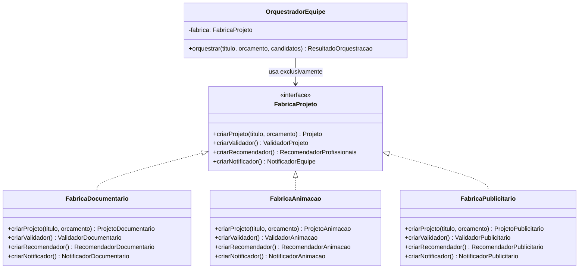
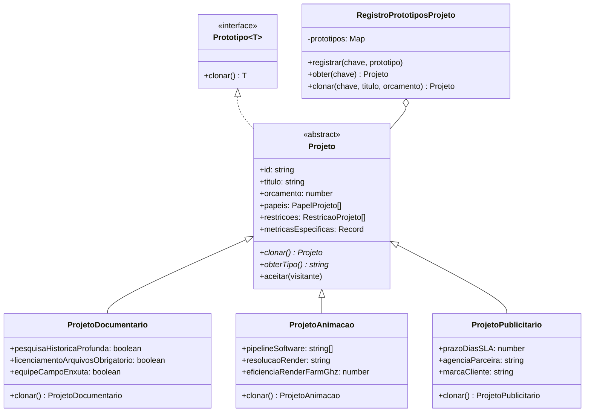

# 🎬 CineBridge Platform — ATVII: Arquitetura de Microsserviços Audiovisuais

[](https://nodejs.org/)
[](https://www.typescriptlang.org/)
[](https://jestjs.io/)
[](https://en.wikipedia.org/wiki/Design_Patterns)
[]()

> **Atividade Prática ATVII**  
> **Disciplina:** Técnicas de Programação II  
> **Docente:** Prof. Dr. Eng. Gerson Penha  
> **Discente / Engenheiro Responsável:** Gabriel Guimarães  
> **Repositório Oficial:** [https://github.com/gabrielbguimaraes/cinebridge-atvii.git](https://github.com/gabrielbguimaraes/cinebridge-atvii.git)  
> **Easter Egg Científico:** `rho_P=c^5/(hbar*G^2)` (20 caracteres — Densidade de Planck frente à singularidade gravitacional)

---

## 📑 Sumário Executivo

1. [Diagnóstico de Arquitetura e Riscos Estruturais](#1-diagnóstico-de-arquitetura-e-riscos-estruturais)
2. [Solução Proposta com Padrões de Projeto (GoF)](#2-solução-proposta-com-padrões-de-projeto-gof)
3. [Estrutura da Base de Código (Clean Architecture)](#3-estrutura-da-base-de-código-clean-architecture)
4. [Diagramas de Classes e Arquitetura](#4-diagramas-de-classes-e-arquitetura)
5. [Detalhamento dos Padrões Implementados](#5-detalhamento-dos-padrões-implementados)
6. [Integração dos Padrões Comportamentais da ATVI](#6-integração-dos-padrões-comportamentais-da-atvi)
7. [Easter Egg Científico](#7-easter-egg-científico)
8. [Instruções de Instalação, Compilação e Execução](#8-instruções-de-instalação-compilação-e-execução)
9. [Suíte de Testes Automatizados (Jest)](#9-suíte-de-testes-automatizados-jest)

---

## 1. Diagnóstico de Arquitetura e Riscos Estruturais

A construção de um sistema de software para a indústria criativa audiovisual independente assemelha-se à engenharia estrutural de uma grande edificação. A ausência de fundações sólidas e padrões arquiteturais consolidados desencadeia três patologias clássicas de projeto que geram acentuada dívida técnica:

* **Rigidez (*Rigidity*):** Qualquer nova demanda — como suportar projetos de animação ou publicidade — exigia a modificação de múltiplos pontos espalhados no código (especialmente condicionais em orquestradores e algoritmos de recomendação), tornando a evolução lenta e custosa.
* **Fragilidade (*Fragility*):** A alteração de regras orçamentárias ou papéis de um gênero específico quebrava silenciosamente o comportamento de outros tipos de produção, gerando efeitos colaterais imprevisíveis e regressões em produção.
* **Imobilidade (*Immobility*):** Módulos de validação e notificação encontravam-se acoplados às classes de projeto concretas, impossibilitando a reutilização de algoritmos e forçando desenvolvedores a reinventar a roda a cada novo formato audiovisual.

A **ATVII da Plataforma CineBridge** resolve integralmente essas deficiências eliminando todas as condicionais de tipo no núcleo do sistema e delegando a criação e coordenação do ecossistema audiovisual a padrões criacionais consolidados.

---

## 2. Solução Proposta com Padrões de Projeto (GoF)

A refatoração introduz três padrões fundamentais da Gang of Four (GoF), perfeitamente integrados aos padrões comportamentais estabelecidos na primeira etapa:

| Padrão | Classificação | Responsabilidade no Domínio CineBridge |
| :--- | :--- | :--- |
| **Prototype** | Criacional | Permite clonagem profunda (*deep copy*) de instâncias complexas de projetos (`ProjetoDocumentario`, `ProjetoAnimacao`, `ProjetoPublicitario`) e seus agregados (`papeis`, `restricoes`, `metricasEspecificas`), viabilizando um registro de modelos pré-configurados (*Prototype Registry*). |
| **Factory Method** | Criacional | Declara métodos especializados nas fábricas para instanciação individual de componentes coesos (`criarProjeto`, `criarValidador`, `criarRecomendador`, `criarNotificador`). |
| **Abstract Factory** | Criacional | Fornece uma interface unificada (`FabricaProjeto`) para criar famílias completas e consistentes de objetos que cooperam entre si (Validador, Recomendador, Notificador e Projeto) sem acoplamento a classes concretas. |
| **Strategy (ATVI)** | Comportamental | Modela algoritmos intercambiáveis de pontuação de candidatos (`EstrategiaDocumentario`, `EstrategiaAnimacao`, `EstrategiaPublicitario`). |
| **Template Method (ATVI)** | Comportamental | Define o esqueleto invariante do algoritmo de validação em `ProcessadorValidacaoTemplate`, delegando passos primitivos específicos às subclasses. |
| **Observer (ATVI)** | Comportamental | Notifica observadores e mantém log de auditoria desacomplado durante a emissão de relatórios (`SujeitoEventos`, `HistoricoAuditoriaObservador`). |
| **Visitor (ATVI)** | Comportamental | Realiza auditoria externa, cálculo de custos e extração de métricas de projetos sem poluir as entidades de domínio (`VisitanteCalculoCustos`). |

---

## 3. Estrutura da Base de Código (Clean Architecture)

```
cinebridge-atvii/
├── package.json                          # Metadados, scripts multiplataforma e Easter Egg
├── tsconfig.json                         # Configurações estritas do TypeScript (noImplicitAny, etc.)
├── jest.config.js                        # Configuração de suíte de testes com ts-jest
├── .gitignore                            # Exclusão de node_modules, dist e relatórios
├── README.md                             # Documentação técnica completa
├── src/
│   ├── index.ts                          # Ponto de entrada CLI, constantes e demonstração completa
│   ├── easterEgg.ts                      # Constante do Easter Egg científico (Densidade de Planck)
│   ├── models/                           # Entidades de domínio e objetos agregados
│   │   ├── Tipos.ts                      # Enums (TipoProjeto, NivelExperiencia, SeveridadeRestricao)
│   │   ├── PapelProjeto.ts               # Papel agregado com clonagem profunda de habilidades
│   │   ├── RestricaoProjeto.ts           # Regra de produção agregada com clonagem profunda
│   │   ├── Profissional.ts               # Candidato audiovisual (habilidades, custo/hora, portfolio)
│   │   └── ResultadoValidacao.ts         # Value object com status, mensagens, erros e avisos
│   ├── patterns/
│   │   ├── prototype/                    # Padrão Prototype & Registry
│   │   │   ├── Prototipo.ts              # Interface genérica Prototipo<T>
│   │   │   ├── Projeto.ts                # Classe abstrata Projeto com deep copy base
│   │   │   ├── ProjetoDocumentario.ts    # Subclasse concreta de Documentário
│   │   │   ├── ProjetoAnimacao.ts        # Subclasse concreta de Animação 3D
│   │   │   ├── ProjetoPublicitario.ts    # Subclasse concreta de Publicidade comercial
│   │   │   └── RegistroPrototiposProjeto.ts # Registry de protótipos pré-configurados
│   │   ├── factory/                      # Padrão Abstract Factory & Factory Method
│   │   │   ├── FabricaProjeto.ts         # Interface Abstract Factory
│   │   │   ├── FabricaDocumentario.ts    # Fábrica concreta da família Documentário
│   │   │   ├── FabricaAnimacao.ts        # Fábrica concreta da família Animação
│   │   │   └── FabricaPublicitario.ts    # Fábrica concreta da família Publicitário
│   │   ├── products/                     # Produtos da Abstract Factory
│   │   │   ├── validadores/              # ValidadorProjeto e implementações
│   │   │   │   ├── ValidadorProjeto.ts
│   │   │   │   ├── ValidadorDocumentario.ts
│   │   │   │   ├── ValidadorAnimacao.ts
│   │   │   │   └── ValidadorPublicitario.ts
│   │   │   ├── recomendadores/           # RecomendadorProfissionais e implementações
│   │   │   │   ├── RecomendadorProfissionais.ts
│   │   │   │   ├── RecomendadorBase.ts
│   │   │   │   ├── RecomendadorDocumentario.ts
│   │   │   │   ├── RecomendadorAnimacao.ts
│   │   │   │   └── RecomendadorPublicitario.ts
│   │   │   └── notificadores/            # NotificadorEquipe e formatos de relatório
│   │   │       ├── NotificadorEquipe.ts
│   │   │       ├── NotificadorDocumentario.ts
│   │   │       ├── NotificadorAnimacao.ts
│   │   │       └── NotificadorPublicitario.ts
│   │   └── atvi_patterns/                # Padrões comportamentais herdados e integrados
│   │       ├── strategy/                 # Estratégias de pontuação de candidatos
│   │       │   ├── EstrategiaPontuacao.ts
│   │       │   └── EstrategiasConcretas.ts
│   │       ├── template_method/          # Template Method de validação
│   │       │   └── ProcessadorValidacaoTemplate.ts
│   │       ├── observer/                 # Observadores de eventos e auditoria
│   │       │   └── ObservadorEvento.ts
│   │       └── visitor/                  # Visitante para cálculo de métricas e custos
│   │           ├── VisitanteProjeto.ts
│   │           └── VisitanteCalculoCustos.ts
│   └── services/                         # Serviços orquestradores desacoplados
│       ├── OrquestradorEquipe.ts         # ZERO CONDICIONAIS DE TIPO (100% OCP / DIP)
│       └── SistemaRecomendacao.ts        # Dispatcher com registro dinâmico de fábricas
└── tests/                                # Suíte completa de testes de integração automatizados
    ├── prototype.test.ts                 # Teste 1: Prototype e garantia de Deep Copy
    ├── abstractFactory.test.ts           # Teste 2: Abstract Factory e OrquestradorEquipe
    ├── extensibility.test.ts             # Teste 3: Extensibilidade OCP com 4ª fábrica (VR)
    └── atvi_patterns.test.ts             # Teste 4: Integração dos padrões ATVI
```

---

## 4. Diagramas de Classes e Arquitetura

### 4.1. Visão Geral da Abstract Factory e Famílias de Produtos



### 4.2. Hierarquia Prototype e Cópia Profunda



---

## 5. Detalhamento dos Padrões Implementados

### 5.1. Prototype & Garantia de Cópia Profunda (Deep Copy)
Cada projeto audiovisual agrega múltiplos objetos compostos:
* `papeis: PapelProjeto[]`: contendo arrays internos de `habilidadesExigidas: string[]`.
* `restricoes: RestricaoProjeto[]`: contendo dicionários de parâmetros de conformidade.
* `metricasEspecificas: Record<string, number | string>`: dados de telemetria específicos.

O método `clonar()` em cada subclasse garante que **nenhuma referência seja compartilhada** com o objeto clonado. Se um produtor ajustar o orçamento de um clone, adicionar papéis ou modificar uma habilidade exigida, o protótipo template original registrado no `RegistroPrototiposProjeto` permanece 100% inalterado.

### 5.2. Abstract Factory & Factory Method
A interface `FabricaProjeto` padroniza a criação do ecossistema:
* **Família Documentário:** produz `ProjetoDocumentario`, `ValidadorDocumentario` (avalia conformidade de cessão de direitos e equipe de campo reduzida), `RecomendadorDocumentario` (prioriza habilidades em entrevistas e pesquisa factual) e `NotificadorDocumentario` (formata diários de campo de produção).
* **Família Animação:** produz `ProjetoAnimacao`, `ValidadorAnimacao` (avalia DCC compatível: Maya/Blender/Houdini e limites de render farm), `RecomendadorAnimacao` (prioriza modelagem 3D, rigging e iluminação) e `NotificadorAnimacao` (relatório técnico com frames e eficiência).
* **Família Publicitário:** produz `ProjetoPublicitario`, `ValidadorPublicitario` (avalia SLA crítico de entrega e aderência a brandbook), `RecomendadorPublicitario` (prioriza agilidade comercial e direção de arte) e `NotificadorPublicitario` (relatório executivo para agência e cliente).

### 5.3. OrquestradorEquipe: Zero Condicionais de Tipo (OCP & DIP)
O `OrquestradorEquipe` recebe a fábrica exclusivamente via injeção de dependência no construtor:
```typescript
export class OrquestradorEquipe {
  constructor(private readonly fabrica: FabricaProjeto) {}

  public orquestrar(titulo: string, orcamento: number, candidatos: Profissional[]): ResultadoOrquestracao {
    const projeto = this.fabrica.criarProjeto(titulo, orcamento);
    const recomendador = this.fabrica.criarRecomendador();
    const validador = this.fabrica.criarValidador();
    const notificador = this.fabrica.criarNotificador();

    const equipe = recomendador.recomendar(projeto, candidatos);
    const validacao = validador.validar(projeto, equipe);
    const notificacao = notificador.notificar(projeto, equipe, ...);

    return { projeto, equipe, validacao, notificacao };
  }
}
```
**Regra Arquitetural Rigorosa:** Não existe nenhum `if`, `else` ou `switch` testando `tipoProjeto` ou usando `instanceof`. O orquestrador opera estritamente acoplado às abstrações, cumprindo:
* **OCP (Open-Closed Principle):** Aberto para extensão (qualquer novo gênero pode ser orquestrado), fechado para modificação (o orquestrador nunca é alterado).
* **DIP (Dependency Inversion Principle):** Módulos de alto nível não dependem de módulos de baixo nível; ambos dependem de abstrações.

### 5.4. SistemaRecomendacao & Dynamic Factory Registry
A classe `SistemaRecomendacao` atua como fachada e registro dinâmico de fábricas, mapeando gêneros a instâncias de `FabricaProjeto`. Permite que novos gêneros (como Realidade Virtual / XR) sejam adicionados em tempo de execução via `sistema.registrarFabrica("REALIDADE_VIRTUAL", novaFabrica)` sem alterar o código do sistema.

---

## 6. Integração dos Padrões Comportamentais da ATVI

1. **Strategy:** A hierarquia de recomendadores utiliza `EstrategiaPontuacao` (`EstrategiaDocumentario`, `EstrategiaAnimacao`, `EstrategiaPublicitario`) para ponderar as competências dos candidatos de acordo com as necessidades prioritárias de cada mídia.
2. **Template Method:** A classe `ProcessadorValidacaoTemplate` implementa o esqueleto algorítmico invariante (`validarDisponibilidade` -> `validarCoberturaPapeis` -> `validarOrcamento` -> `validarRegrasEspecificas` -> `hookAposValidacao`), enquanto os validadores concretos implementam apenas o passo primitivo abstrato `validarRegrasEspecificas`.
3. **Observer:** Os notificadores estendem `SujeitoEventos`, notificando observadores cadastrados (como `HistoricoAuditoriaObservador`) a cada despacho de notificação sem criar acoplamento com o mecanismo de log.
4. **Visitor:** A interface `VisitanteProjeto` e o visitante concreto `VisitanteCalculoCustos` visitam instâncias de `Projeto`, extraindo métricas analíticas e custos médios por papel sem adicionar lógica contábil à entidade de domínio.

---

## 7. Easter Egg Científico

Conforme os critérios de avaliação acadêmica do **Prof. Dr. Eng. Gerson Penha**, o projeto traz como assinatura de autoria única o limite superior da **Densidade de Planck** frente à singularidade teórica de buracos negros:

$$\rho_P = \frac{c^5}{\hbar G^2}$$

* **Constante Exata (20 caracteres):** `rho_P=c^5/(hbar*G^2)`
* **Localização 1 (Configuração):** Propriedade customizada no [package.json](file:///c:/Users/Biel_/tec2-atvii/package.json):
  ```json
  "easterEgg": "rho_P=c^5/(hbar*G^2)"
  ```
* **Localização 2 (Código-Fonte):** Comentário de cabeçalho e constante exportada em [src/index.ts](file:///c:/Users/Biel_/tec2-atvii/src/index.ts) e [src/easterEgg.ts](file:///c:/Users/Biel_/tec2-atvii/src/easterEgg.ts):
  ```typescript
  // EasterEgg: rho_P=c^5/(hbar*G^2)
  export const EASTER_EGG = "rho_P=c^5/(hbar*G^2)";
  ```

---

## 8. Instruções de Instalação, Compilação e Execução

O projeto é 100% compatível com **Windows 10/11** e **Linux Ubuntu 24.04 LTS (ou superior)**, utilizando caminhos relativos universais e scripts NPM puros.

### 8.1. Pré-requisitos
* Node.js v20.x ou superior (testado em Node.js v24.19.0)
* NPM v10.x ou superior (testado em NPM v11.17.0)

### 8.2. Instalação das Dependências
```bash
npm install
```

### 8.3. Compilação TypeScript (Type-Check & Build)
```bash
npm run build
```
*(Gera os arquivos `.js`, `.d.ts` e `.js.map` estritamente tipados no diretório `dist/`).*

### 8.4. Execução dos Testes Automatizados
```bash
npm test
```
Para relatório de cobertura de código:
```bash
npm run test:coverage
```

### 8.5. Execução da Demonstração no Console (CLI)
```bash
npm start
```
*(Ou, alternativamente, executando a versão compilada via `node dist/index.js`).*

---

## 9. Suíte de Testes Automatizados (Jest)

A cobertura de testes de integração é composta por 4 suítes abrangentes executadas sequencialmente:

1. **`tests/prototype.test.ts` (Teste 1 - Prototype & Deep Copy):**
   * Clona `ProjetoDocumentario`, `ProjetoAnimacao` e `ProjetoPublicitario`.
   * Adiciona novos papéis, restrições e altera propriedades agregadas internas no clone.
   * Valida por asserções estritas que os protótipos originais no registro mantiveram quantidade de papéis, restrições e valores de métricas rigorosamente inalterados.
2. **`tests/abstractFactory.test.ts` (Teste 2 - Famílias Coesas):**
   * Alterna entre `FabricaDocumentario`, `FabricaAnimacao` e `FabricaPublicitario` no `OrquestradorEquipe`.
   * Comprova que cada orquestração gera projetos, recomendações de profissionais especializadas, validações de regras específicas e formatos de notificação próprios do gênero audiovisual.
3. **`tests/extensibility.test.ts` (Teste 3 - Open-Closed Principle):**
   * Declara uma 4ª família completa simulada: `ProjetoRealidadeVirtual`, `ValidadorRealidadeVirtual`, `RecomendadorRealidadeVirtual`, `NotificadorRealidadeVirtual` e `FabricaRealidadeVirtual`.
   * Executa a orquestração via `OrquestradorEquipe` e registra a fábrica em `SistemaRecomendacao`.
   * Comprova que o sistema acomodou perfeitamente o novo gênero **sem alterar uma única linha de código** do núcleo da aplicação.
4. **`tests/atvi_patterns.test.ts` (Teste 4 - Integração de Padrões ATVI):**
   * Valida as estratégias de pontuação (Strategy), observadores de eventos com auditoria (Observer) e visitantes de custos e complexidade (Visitor).

---

© 2026 Plataforma CineBridge — Técnicas de Programação II. Todos os direitos reservados.