# CineBridge — ATVII


> **Atividade Prática ATVII**  
> **Disciplina:** Técnicas de Programação II  
> **Docente:** Prof. Dr. Eng. Gerson Penha

---


---

## 1. Diagrama de Classes

```mermaid
classDiagram
    direction TB

    %% --- PADRÕES COMPORTAMENTAIS (ATVI) COMO PRODUTOS DA FÁBRICA (ATVII) ---
    class VisitanteProjeto {
        <<interface>>
        +visitarProjeto(projeto: Projeto) boolean
        +visitarProfissional(profissional: Profissional) boolean
    }

    class RecomendacaoStrategy {
        <<interface>>
        +recomendar(projeto: Projeto, profissionais: Profissional[]) Map~Papel, Profissional[]~
    }

    class Observador {
        <<interface>>
        +atualizar(evento: EventoRecomendacao) void
    }

    class ValidadorDocumentario {
        +visitarProjeto(projeto: Projeto) boolean
        +visitarProfissional(profissional: Profissional) boolean
    }

    class ValidadorAnimacao {
        +visitarProjeto(projeto: Projeto) boolean
        +visitarProfissional(profissional: Profissional) boolean
    }

    class ValidadorPublicitario {
        +visitarProjeto(projeto: Projeto) boolean
        +visitarProfissional(profissional: Profissional) boolean
    }

    VisitanteProjeto <|.. ValidadorDocumentario
    VisitanteProjeto <|.. ValidadorAnimacao
    VisitanteProjeto <|.. ValidadorPublicitario

    class RecomendadorDocumentario {
        +recomendar(projeto: Projeto, profissionais: Profissional[]) Map~Papel, Profissional[]~
    }

    class RecomendadorAnimacao {
        +recomendar(projeto: Projeto, profissionais: Profissional[]) Map~Papel, Profissional[]~
    }

    class RecomendadorPublicitario {
        +recomendar(projeto: Projeto, profissionais: Profissional[]) Map~Papel, Profissional[]~
    }

    RecomendacaoStrategy <|.. RecomendadorDocumentario
    RecomendacaoStrategy <|.. RecomendadorAnimacao
    RecomendacaoStrategy <|.. RecomendadorPublicitario

    class NotificadorDocumentario {
        +atualizar(evento: EventoRecomendacao) void
    }

    class NotificadorAnimacao {
        +atualizar(evento: EventoRecomendacao) void
    }

    class NotificadorPublicitario {
        +atualizar(evento: EventoRecomendacao) void
    }

    Observador <|.. NotificadorDocumentario
    Observador <|.. NotificadorAnimacao
    Observador <|.. NotificadorPublicitario

    %% --- PADRÃO ABSTRACT FACTORY (CRIACIONAL) ---
    class FabricaProjeto {
        <<interface>>
        +criarProjeto(dados: any) Projeto
        +criarValidador() VisitanteProjeto
        +criarRecomendador() RecomendacaoStrategy
        +criarNotificador() Observador
    }

    class FabricaDocumentario {
        +criarProjeto(dados: any) ProjetoDocumentario
        +criarValidador() VisitanteProjeto
        +criarRecomendador() RecomendacaoStrategy
        +criarNotificador() Observador
    }

    class FabricaAnimacao {
        +criarProjeto(dados: any) ProjetoAnimacao
        +criarValidador() VisitanteProjeto
        +criarRecomendador() RecomendacaoStrategy
        +criarNotificador() Observador
    }

    class FabricaPublicitario {
        +criarProjeto(dados: any) ProjetoPublicitario
        +criarValidador() VisitanteProjeto
        +criarRecomendador() RecomendacaoStrategy
        +criarNotificador() Observador
    }

    FabricaProjeto <|.. FabricaDocumentario
    FabricaProjeto <|.. FabricaAnimacao
    FabricaProjeto <|.. FabricaPublicitario

    FabricaDocumentario ..> ValidadorDocumentario : cria
    FabricaDocumentario ..> RecomendadorDocumentario : cria
    FabricaDocumentario ..> NotificadorDocumentario : cria

    FabricaAnimacao ..> ValidadorAnimacao : cria
    FabricaAnimacao ..> RecomendadorAnimacao : cria
    FabricaAnimacao ..> NotificadorAnimacao : cria

    FabricaPublicitario ..> ValidadorPublicitario : cria
    FabricaPublicitario ..> RecomendadorPublicitario : cria
    FabricaPublicitario ..> NotificadorPublicitario : cria

    %% --- PADRÕES PROTOTYPE + FACTORY METHOD ---
    class Projeto {
        <<abstract>>
        #id: string
        #genero: string
        #duracao: number
        #orcamento: number
        #prazo: Date
        #papeis: Papel[]
        #equipe: Map~Papel, Profissional[]~
        #fabrica: FabricaProjeto
        +getId() string
        +getGenero() string
        +getDuracao() number
        +getOrcamento() number
        +getPrazo() Date
        +getPapeis() Papel[]
        +getEquipe() Map~Papel, Profissional[]~
        +getFabrica() FabricaProjeto
        +aceitarRecomendacao(papel: Papel, profissional: Profissional) void
        +substituirMembro(papel: Papel, profissional: Profissional) void
        +solicitarReavaliacao() void
        +clonar()* Projeto
        +criarFabrica()* FabricaProjeto
    }

    class ProjetoDocumentario {
        +tema: string
        +entrevistados: string[]
        +clonar() ProjetoDocumentario
        +criarFabrica() FabricaProjeto
    }

    class ProjetoAnimacao {
        +estiloAnimacao: string
        +softwareModelagem3D: string[]
        +clonar() ProjetoAnimacao
        +criarFabrica() FabricaProjeto
    }

    class ProjetoPublicitario {
        +marcaCliente: string
        +canaisVeiculacao: string[]
        +clonar() ProjetoPublicitario
        +criarFabrica() FabricaProjeto
    }

    Projeto <|-- ProjetoDocumentario
    Projeto <|-- ProjetoAnimacao
    Projeto <|-- ProjetoPublicitario

    Projeto o-- "0..1" FabricaProjeto : contem
    ProjetoDocumentario ..> FabricaDocumentario : instancia
    ProjetoAnimacao ..> FabricaAnimacao : instancia
    ProjetoPublicitario ..> FabricaPublicitario : instancia

    %% --- PADRÃO TEMPLATE METHOD: ORQUESTRADOR ---
    class OrquestradorEquipe {
        <<abstract>>
        #fabrica: FabricaProjeto
        +orquestrar(projeto: Projeto, estrategia: RecomendacaoStrategy) Equipe
        #validarRestricoes(projeto: Projeto)* boolean
        #normalizarDados(projeto: Projeto, profissionais: Profissional[])* Profissional[]
        #posProcessar(recomendacoes: Map~Papel, Profissional[]~)* Map~Papel, Profissional[]~
    }

    class OrquestradorPadrao {
        #validarRestricoes(projeto: Projeto) boolean
        #normalizarDados(projeto: Projeto, profissionais: Profissional[]) Profissional[]
        #posProcessar(recomendacoes: Map~Papel, Profissional[]~) Map~Papel, Profissional[]~
    }

    OrquestradorEquipe <|-- OrquestradorPadrao
    OrquestradorEquipe --> "1" FabricaProjeto : depende

    class SistemaRecomendacao {
        -fabricas: Map~string, FabricaProjeto~
        +processarSolicitacao(tipoOuProjeto, tituloOuEstrategia, orcamento, candidatos) Equipe
        +registrarFabrica(tipo: string, fabrica: FabricaProjeto) void
        +obterFabrica(tipo: string) FabricaProjeto
    }

    SistemaRecomendacao ..> OrquestradorPadrao : instancia

    %% --- MODELOS E ENTIDADES DE DOMÍNIO ---
    class Papel {
        +id: string
        +nome: string
        +nivelMinimo: NivelExperiencia
        +habilidadesExigidas: string[]
        +quantidade: number
        +clonar() Papel
    }

    class Profissional {
        +id: string
        +nome: string
        +papelPrincipal: string
        +nivel: NivelExperiencia
        +habilidades: string[]
        +custoHora: number
        +disponivel: boolean
    }

    class Equipe {
        +membros: Map~Papel, Profissional[]~
        +projeto: Projeto
        +validacao: ResultadoValidacao
        +notificacao: string
        +obterTodosProfissionais() Profissional[]
    }

    class EventoRecomendacao {
        +tipo: string
        +projeto: Projeto
        +equipe: Map~Papel, Profissional[]~
        +mensagem: string
        +timestamp: Date
    }

    Projeto *-- Papel : agrega
    Equipe o-- Profissional : compoe
    Equipe o-- Papel : mapeia
    Observador ..> EventoRecomendacao : recebe
```




---
## 2. Instruções


### 2.1. Instalação das Dependências
```bash
npm install
```

### 2.2. Compilação TypeScript
```bash
npm run build
```
*(Gera os arquivos `.js`, `.d.ts` e `.js.map` estritamente tipados no diretório `dist/`).*

### 2.3. Execução dos Testes Automatizados
```bash
npm test
```
Para relatório de cobertura de código:
```bash
npm run test:coverage
```

### 2.4. Execução da Demonstração no Console
```bash
npm start
```

---
